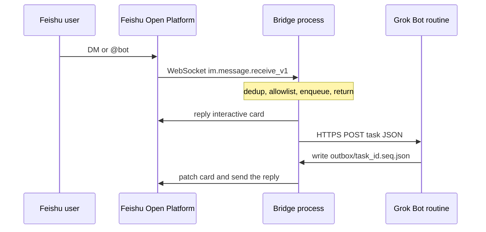

# 架構

English: one process holds the Feishu WebSocket, a dispatcher thread, and an outbox watcher. Feishu events are acknowledged inside the handler by enqueueing only. Replies come back as files on a shared disk.

## 行程內的三條路

| 部分 | 做什麼 | 不做什麼 |
| --- | --- | --- |
| `lark.ws.Client` 上的 handler | 解析文字與富文本、去掉 @、去重、允許名單、入 SQLite 佇列 | 不呼叫飛書發訊 API，不呼叫 webhook |
| dispatcher 執行緒 | 回一張「已收到，處理中…」卡片，組任務 JSON，POST webhook，失敗時把卡片改成紅色 | 不等待 Grok Bot 做完 |
| outbox watcher | watchdog，失敗時改輪詢。讀結果檔，更新卡片、送文字或檔案 | 不持有飛書 secret 以外的路徑邏輯；secret 只在這個行程 |

SDK 細節對過 lark-oapi 1.7.5：

- 長連接是 `lark_oapi.ws.Client`（`import lark_oapi as lark` 時寫成 `lark.ws.Client`）。`start()` 會擋住，而且沒有公開的 `stop()`。收到 SIGTERM / SIGINT 時，橋接會請 SDK 那個 event loop 停下來。
- 發卡片與後續文字用 `client.im.v1.message.reply`。更新卡片用 `client.im.v1.message.patch`（只接受互動卡片 JSON）。上傳用 `client.im.v1.file.create` 與 `client.im.v1.image.create`。tenant token 由 SDK 自己換。

`/help`、`/status`、`/history`、`/ping` 在 dispatcher 裡本地回答，不會打 webhook。

SQLite（`BRIDGE_DB_PATH`）記下看過的 `event_id` 與 `message_id`、任務狀態、每則聊天最近的對話。飛書重推時 `message_id` 可能配上新的 `event_id`，所以兩個都算重複。
